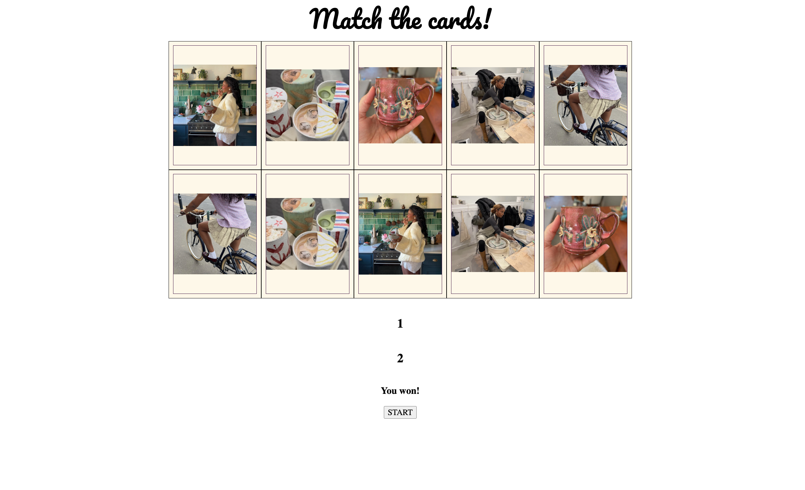

# Match the Cards 🪷

A memory card game where you flip over cards and try to find all the matching pairs.

## Description

This is a card matching game I made to practice JavaScript. There are 10 cards face down on the table, and every card has a match. Flip two cards at a time to find the pairs. If you match all 5 pairs, you win. I built it to practice working with the DOM, click events, and keeping track of the game with variables.

## DEMO

<!-- Add a screenshot: Cmd + Shift + 4 on Mac, save it in assets/images/, then update the file name below -->

## Features

- 10 cards (5 pairs) that get shuffled every new game
- Click a card to flip it over
- If the two cards match, they stay face up
- If they don't match, they flip back over after a short delay
- Keeps count of your wins and your misses
- A **START** button to shuffle the cards and play again
- Shows a "You won!" message when you find every pair

## Tech Used

- HTML
- CSS
- JavaScript

## How to Use

1. Open the game in your browser
2. Click a card to flip it over.
3. Click a second card to try to find its match.
4. Keep going until all 5 pairs are matched.
5. Click **START** to shuffle the cards and play again.

## How It Works

- The cards are in an array, and each picture shows up twice.
- When the game starts, the cards get shuffled by picking random pictures from a copy of the array.
- The first card you click is saved. When you click the second one, the game checks if the two pictures are the same.
- If they match, the match count goes up. When it hits 5, you win.
- If they don't match, the cards flip back over.

## What I Learned

- How to use `setTimeout` to wait before something happens
- How to shuffle an array with `Math.random`

## Author

Maya Rose — [GitHub](https://github.com/Mayaerose) 🌹
